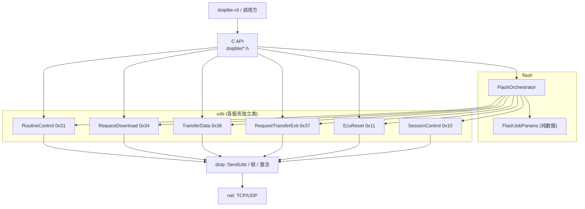
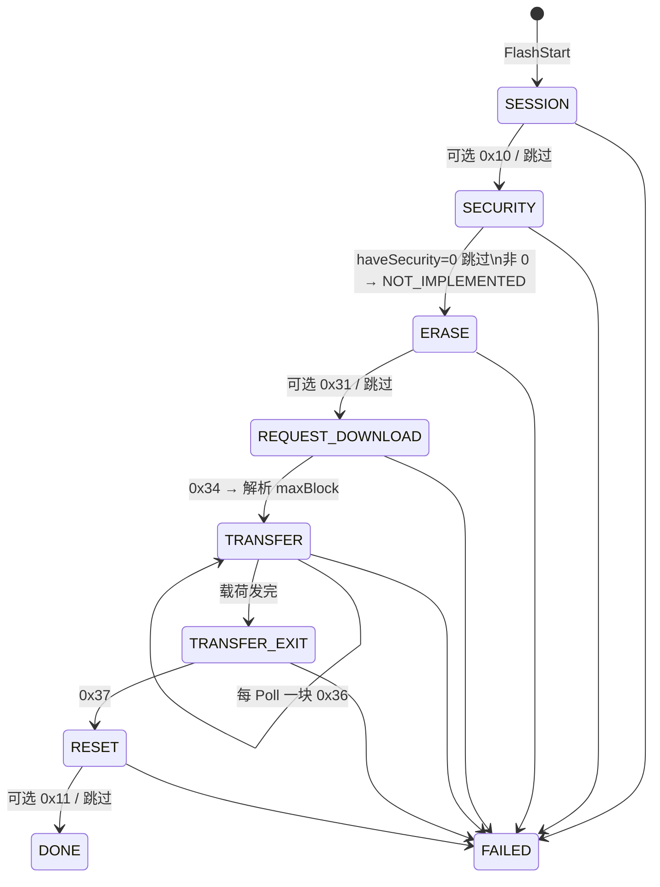

# DoipLite

DoipLite 是一个轻量级 C++ 库，用于在工控机上通过以太网做 **DoIP**（ISO 13400-2 通用部分）诊断传输，并在其上发送 **UDS**（ISO 14229）请求。核心库不依赖 Qt。

当前已实现：**M1**（UDP 车辆发现、TCP 诊断连接、路由激活），DoIP 诊断消息托运（`DoipLiteSendUds`），UDS **0x22 / 0x10 / 0x3E**，以及本里程碑的刷写相关服务：**0x31 RoutineControl**、**0x34 RequestDownload**、**0x36 TransferData**、**0x37 RequestTransferExit**、**0x11 ECUReset**，以及 `flash` 层编排状态机（`DoipLiteFlashStart` / `DoipLiteFlashPoll`）。**0x27 安全访问尚未实现**（`DoipLiteSetSeedKeyCallback` 仅保存回调，状态机未接线）。

本库只实现通用 ISO 13400-2 / ISO 14229 行为，不包含厂商/OEM 私有扩展。逻辑地址、例程 ID、内存地址、复位类型、会话类型等均由调用参数或配置传入，库代码不写入现场地址或密钥。

## 分层与模块边界



- `net`：UDP/TCP，不含诊断语义
- `doip`：DoIP 帧、车辆发现、路由激活、诊断消息托运；会话拥有可选的 `FlashOrchestrator`
- `uds`：每个服务一个聚焦的内部 C++ 类（Rule of Zero / 静态 `execute`），只通过 `DoipLiteSendUds`（或 Internal）发送；**不**组装 DoIP 头。对外仍是 C API
- `flash`：`FlashJobParams` 只存作业数据；`FlashOrchestrator` 只编排 UDS 调用，**不**直接碰套接字或拼协议字节

### 刷写状态机（关键路径）



未提供的可选步骤会被跳过；缺下载/载荷参数时 `FlashStart` 返回 `INVALID_ARG`。库**不会**默认进入编程会话 `0x02`。长传过程中的周期性 TesterPresent 保活留作后续工作。

## 路线图

1. **M1**：UDP 车辆发现、TCP 诊断连接、路由激活（已实现）
2. **M2**：`DoipLiteSendUds` + 0x22 / 0x10 / 0x3E（已实现）
3. **M3**：传包/升级状态机 0x31/0x34/0x36/0x37/0x11（本 PR）；安全访问只走回调（**尚未接线**）
4. **M4**：Qt 作业界面（**不在本仓库**）
5. **M5**：与服务器做 HTTPS/REST 版本比对（非第一优先）

## 构建

需要 CMake 3.16+、C++17 编译器。网络层使用 **standalone Asio**（仅 Asio，不是整套 Boost），由 CMake FetchContent 拉取；也可用 `-DASIO_ROOT=` 指向本地 Asio 源码树。

### Linux（编译与模拟测试）

```bash
cmake -S . -B build -DCMAKE_CXX_COMPILER=g++ -DDOIPLITE_BUILD_TESTS=ON
cmake --build build
ctest --test-dir build --output-on-failure
```

测试使用进程内回环 DoIP 模拟器（`127.0.0.1` 上的临时端口）。Windows/MSVC 本环境未验证。

## 配置与密钥

现场 IP、例程 ID、内存地址、复位类型等**不要**写进库代码。`examples/config/example.conf` 仅含注释占位键名，请换成你自己的值，且不要提交真实现场配置。

UDS 安全访问的种子—密钥算法不在本库实现；`DoipLiteSetSeedKeyCallback` 可注册但本 PR 刷写路径不会调用。详见 [SECURITY.md](SECURITY.md)。

## 命令行

`doiplite-cli` 支持：`discover`、`activate`、`read-version`、`session`、`tester-present`、`routine-control`、`request-download`、`transfer-data`、`request-transfer-exit`、`ecu-reset`、`flash`。

配置键均为显式唯一名称（例如 `routine_sub_function`、`download_alfid`、`flash_session_type`、`ecu_reset_type`、`package_path`），避免裸 `sub_function` 在多命令间碰撞。命令行覆盖配置文件。

## 许可证

MIT。本库只提供通用协议实现，不包含 OEM 规范文档或密钥。
