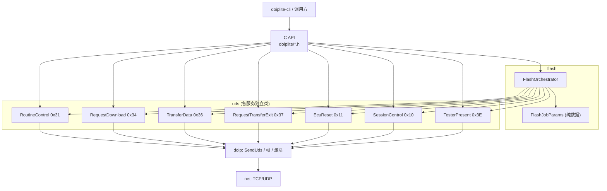
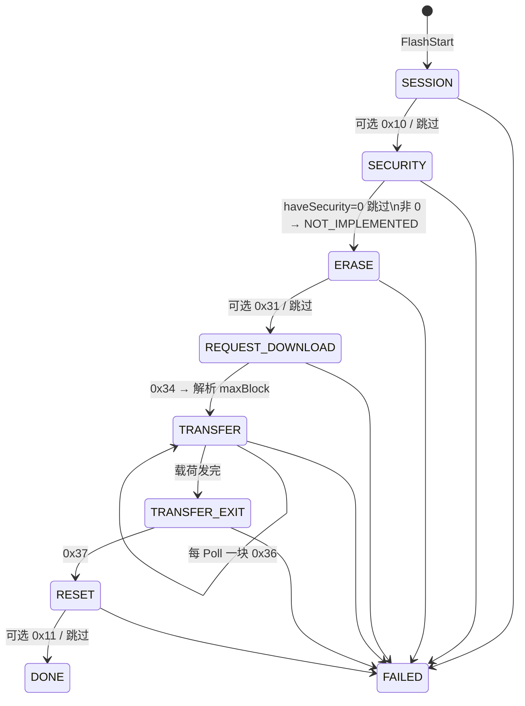

# DoipLite

DoipLite 是一个轻量级 C++ 库，用于在工控机上通过以太网做 **DoIP**（ISO 13400-2 通用部分）诊断传输，并在其上发送 **UDS**（ISO 14229）请求。核心库不依赖 Qt。

当前已实现：**M1**（UDP 车辆发现、TCP 诊断连接、路由激活，以及 `doiplite-cli` 的 `discover` / `activate`），DoIP 诊断消息托运（`DoipLiteSendUds`，payload type 0x8001 / 0x8002 ACK / 0x8003 NACK），UDS **0x22 / 0x10 / 0x3E**，以及刷写相关服务：**0x31 RoutineControl**、**0x34 RequestDownload**、**0x36 TransferData**、**0x37 RequestTransferExit**、**0x11 ECUReset**，以及 `flash` 层编排状态机（`DoipLiteFlashStart` / `DoipLiteFlashPoll`）。长传过程中的周期性 TesterPresent（0x3E）保活由作业参数配置（无库默认间隔/子功能）。**0x27 安全访问尚未实现**（`DoipLiteSetSeedKeyCallback` 仅保存回调，状态机未接线）。

本库只实现通用 ISO 13400-2 / ISO 14229 行为，不包含厂商/OEM 私有扩展。逻辑地址、例程 ID、内存地址、复位类型、会话类型、TesterPresent 子功能等均由调用参数或配置传入，库代码不写入现场地址或密钥。

## 分层与模块边界



- `net`：UDP/TCP，不含诊断语义
- `doip`：DoIP 帧、车辆发现、路由激活、诊断消息托运；会话拥有可选的 `FlashOrchestrator`
- `uds`：每个服务一个聚焦的内部 C++ 类（Rule of Zero / 静态 `execute`），只通过 `DoipLiteSendUds`（或 Internal）发送；**不**组装 DoIP 头。对外仍是 C API
- `flash`：`FlashJobParams` 只存作业数据；`FlashOrchestrator` 只编排 UDS 调用，**不**直接碰套接字或拼协议字节

对外提供 C API（见 `include/doiplite/`），便于之后在其它工程（例如 Qt 作业界面）中调用。

### 刷写状态机（关键路径）



未提供的可选步骤会被跳过；缺下载/载荷参数时 `FlashStart` 返回 `INVALID_ARG`。库**不会**默认进入编程会话 `0x02`。

周期性 TesterPresent 保活：当作业同时提供 `keepAliveIntervalMs`（非 0）与 `haveKeepAliveSubFunction` + `keepAliveSubFunction` 时，`FlashOrchestrator` 仅在 flash 步骤之间或 0x36 块之间、会话可能空闲时调用既有 `UdsTesterPresent`；**不会**在等待 UDS 应答（含 NRC `0x78`）期间插入。间隔或子功能未提供时不发送周期性 `0x3E`（库不发明默认值）。CLI / 配置键为 `flash_keep_alive_interval_ms` 与 `flash_keep_alive_sub_function`（不用裸 `sub_function`）。

传输进度按 64 位中间运算映射到 20%..90%，避免大于约 61 MiB 的包在 `done * 70` 时溢出。

## 路线图

1. **M1**：UDP 车辆发现、TCP 诊断连接、路由激活（已实现）
2. **M2**：`DoipLiteSendUds` + 0x22 / 0x10 / 0x3E（已实现）
3. **M3**：传包/升级状态机 0x31/0x34/0x36/0x37/0x11 + 可选周期性 0x3E 保活（已实现）；安全访问只走回调（**尚未接线**）
4. **M4**：Qt 作业界面（**不在本仓库**）
5. **M5**：与服务器做 HTTPS/REST 版本比对（非第一优先）

## 构建

需要 CMake 3.16+、C++17 编译器。网络层使用 **standalone Asio**（仅 Asio，不是整套 Boost），由 CMake FetchContent 拉取；也可用 `-DASIO_ROOT=` 指向本地 Asio 源码树（需含 `include/asio.hpp`），便于离线工控机环境。

### Windows（MSVC）

```powershell
cmake -S . -B build -G "Visual Studio 17 2022" -A x64
cmake --build build --config Release
```

MSVC 2019 同样支持（换对应生成器即可）。主目标是 Windows 10/11 x64。

### Linux（编译与模拟测试）

```bash
cmake -S . -B build -DCMAKE_CXX_COMPILER=g++ -DDOIPLITE_BUILD_TESTS=ON
cmake --build build
ctest --test-dir build --output-on-failure
```

测试使用进程内回环 DoIP 模拟器（`127.0.0.1` 上的临时端口），不会访问非回环网络，也不包含密钥或现场数据。构建测试时还会生成辅助程序 `doiplite-loopback-sim`，可手动与 CLI 联调：

```bash
./build/doiplite-loopback-sim
# 该进程会打印 listening 127.0.0.1 <port>
./build/doiplite-cli discover --broadcast 127.0.0.1 --port <port> --timeout-ms 1000
./build/doiplite-cli activate --ip 127.0.0.1 --port <port> --tester-addr 0x0E00
./build/doiplite-cli read-version --ip 127.0.0.1 --port <port> --tester-addr 0x0E00 --did 0x0001
./build/doiplite-cli session --ip 127.0.0.1 --port <port> --tester-addr 0x0E00 --session 0x01
./build/doiplite-cli tester-present --ip 127.0.0.1 --port <port> --tester-addr 0x0E00 --sub-function 0x00
```

回环模拟器会对示例 DID `0x0001` 返回可打印的假版本字符串 `SIM-1.0`（仅供本地联调，不是现场 DID）。默认模拟器对 UDS 0x10 / 0x3E / 0x11 / 0x31 在 suppressPositiveResponse（bit7）置位时保持静默；测试中也可配置仅接受某一会话类型、TesterPresent 子功能或例程 ID，或附带示例 P2/P2* 时序参数。

## 公共 C API 示例

可选目标（`-DDOIPLITE_BUILD_EXAMPLES=ON`，默认开启）构建两个可执行示例，仅使用公共 C API：

- `doiplite-example-read-version`：发现 → 按配置身份唯一选设备 → 激活 → 读 `version_did`
- `doiplite-example-flash-job`：默认干跑校验/打印刷写计划；加 `--execute` 才联网刷写（可擦写/复位 ECU）

配置模板见 `examples/config/station_template.conf`；中文说明见 `examples/README_zh.md`。示例层配置解析不进入核心库。

```bash
cmake -S . -B build -G Ninja -DDOIPLITE_BUILD_EXAMPLES=ON -DDOIPLITE_BUILD_TESTS=ON
# 离线 Asio：-DASIO_ROOT=/path/to/asio
cmake --build build
./build/doiplite-example-flash-job --config /path/to/your_station.conf
```

## 配置与密钥

现场 IP、例程 ID、内存地址、复位类型、会话类型、TesterPresent 子功能、保活间隔等**不要**写进库代码。`examples/config/example.conf` 与 `examples/config/station_template.conf` 仅含注释占位键名，请换成你自己的值，且不要提交真实现场配置。

UDS 安全访问的种子—密钥算法不在本库实现；`DoipLiteSetSeedKeyCallback` 可注册但刷写路径不会调用。详见 [SECURITY.md](SECURITY.md)。

## 命令行

`doiplite-cli` 支持：`discover`、`activate`、`read-version`、`session`、`tester-present`、`routine-control`、`request-download`、`transfer-data`、`request-transfer-exit`、`ecu-reset`、`flash`。

- `--help`：打印用法，退出码 0
- `discover`：发送车辆识别请求并收集应答，打印每个实体的 IP 与逻辑地址
- `activate`：对指定 IPv4/端口建立 TCP 连接并做路由激活
- `read-version`：路由激活后发送 UDS 0x22；DID 必须由 `--did` / `version_did` 提供
- `session`：路由激活后发送 UDS 0x10；会话类型必须由 `--session` / `session_type` 提供（无库默认、也不默认编程会话）
- `tester-present`：路由激活后发送 UDS 0x3E；子功能必须由 `--sub-function` / `tester_present_sub_function` 提供（无库默认）
- `routine-control` / `request-download` / `transfer-data` / `request-transfer-exit` / `ecu-reset`：单步 UDS 服务
- `flash`：编排刷写序列；可选周期性保活键 `flash_keep_alive_interval_ms` + `flash_keep_alive_sub_function`

配置键均为显式唯一名称（例如 `routine_sub_function`、`download_alfid`、`flash_session_type`、`ecu_reset_type`、`package_path`、`flash_keep_alive_sub_function`），避免裸 `sub_function` 在多命令间碰撞。命令行覆盖配置文件。

默认发现目标为有限广播 `255.255.255.255:13400`，也支持单播（例如 `127.0.0.1`）。未指定测试仪逻辑地址时，诊断命令使用 **0x0E00** 作为示例默认值（ISO 13400 外部测试设备地址段起始值，**不是**现场地址）。激活类型默认 `0x00`（ISO 默认激活）。

扩展 API：`DoipLiteDiscoverEx`、`DoipLiteRoutingActivationEx`、`DoipLiteLastDoipCode` / `DoipLiteEntityAddress`、`DoipLiteSetP2Timing` / `DoipLiteGetP2Timing`。路由激活在超时或网络失败（含半帧、断连或无法解析的帧）时关闭 TCP，并清除激活状态与 **EntityAddress**，同一会话再次激活会重新连接，不会复用迟到/残留应答或陈旧实体地址；完整的 DoIP NACK 仍返回 `DOIPLITE_ERR_DOIP_NACK` 并保留响应码。`DoipLiteSendUds` 在已激活会话上发送 0x8001 并等待 UDS 应答；接收超时或传输中途失败同样关闭 TCP 并清除激活与 EntityAddress。

UDS 等待按 ISO 14229 P2 / P2*：首应答窗口为 `timeoutMs`（非 0）或会话 P2（默认 `DOIPLITE_DEFAULT_P2_MS` = 50ms）；每收到 NRC `0x78` 后将窗口重置为完整会话 P2*（默认 `DOIPLITE_DEFAULT_P2_STAR_MS` = 5000ms）；`0x78` 不是最终 NRC。`UdsDiagnosticSessionControl` / `UdsTesterPresent` / `UdsEcuReset` / `UdsRoutineControl` 在子功能 bit7（suppressPositiveResponse）置位时：P2 内静默视为成功且不关闭 TCP；若先收到 `0x78` 再静默，按 P2* 超时处理（不是成功）。CLI 的 `--session` / `--sub-function` 等在收窄为 8 位前校验完整宽度。

## 许可证

MIT。本库只提供通用协议实现，不包含 OEM 规范文档或密钥。
